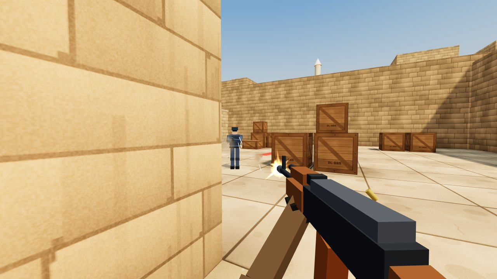

# Dustline

A free, open-source 5v5 tactical shooter that runs in any modern browser. Pick a side, buy your gear, and play bomb defusal rounds against bots on a desert map. Desktop and phones are both supported.

**[Play in your browser](https://nguyenphong-dev.github.io/dustline/)** · **[Download for Mac or Windows](https://github.com/NguyenPhong-dev/dustline/releases/latest)**



Dustline is inspired by classic bomb-defusal shooters such as Counter-Strike. It is an independent fan project and is not affiliated with Valve. Every model, texture and sound is generated in code, so the game ships no asset files.

## Play

**In your browser:** go to https://nguyenphong-dev.github.io/dustline/. There is nothing to install, and it works on phones too.

**Mac app:** download the zip for your Mac from [Releases](https://github.com/NguyenPhong-dev/dustline/releases/latest): `Dustline-1.0.0-mac-arm64.zip` for Apple Silicon (M1 and later) or `Dustline-1.0.0-mac-x64.zip` for Intel. Apple menu → About This Mac shows which one you have. Unzip it and drag Dustline into Applications. The app is not notarized by Apple, so macOS blocks it the first time: open System Settings → Privacy & Security, scroll down and click **Open Anyway**. If macOS says the app "is damaged" instead, run `xattr -dr com.apple.quarantine /Applications/Dustline.app` in Terminal and open it again.

**Windows app:** download `Dustline-1.0.0-win-x64.zip` from [Releases](https://github.com/NguyenPhong-dev/dustline/releases/latest), right-click it and choose **Extract All**, then open the extracted Dustline folder and run `Dustline.exe`. It runs on 64-bit Windows 10 and 11. The app is not signed, so Windows may say "Windows protected your PC" the first time: click **More info**, then **Run anyway**. Press F11 for fullscreen and Alt+F4 to quit.

**Offline in a browser:** click Code → Download ZIP, unzip it and open `index.html` in Chrome, Edge, Firefox or Safari. three.js and the fonts are bundled, so no internet connection is needed.

**Build the Mac app yourself:** run `desktop/build-mac.sh`, or `desktop/build-mac.sh x64` for an Intel Mac. It needs no Node.js or npm. The script downloads the official Electron 44 release (about 124 MB), checks its SHA-256 checksum, adds the game and builds `desktop/dist/Dustline.app`. Drag that into Applications. The desktop edition opens in its own window, remembers its size, has F11 and Ctrl+Cmd+F fullscreen, and a Quit button in the menu. The script signs the app only for the Mac that built it. To hand out copies without the security warning, sign and notarize it with an Apple Developer ID.

**Build the Windows app yourself:** on macOS or Linux, run `desktop/build-windows.sh`, or `desktop/build-windows.sh arm64` for Windows on Arm. The script downloads the official Electron release for Windows, checks its SHA-256 checksum, adds the game and writes the `desktop/dist/win-x64/Dustline` folder and a zip of it. If Node.js 20 or later is installed, it also gives `Dustline.exe` the Dustline icon and file details with the [resedit](https://github.com/jet2jet/resedit-js) library, which it downloads from npm at a fixed version and checks against its published hash. Without Node.js the exe keeps Electron's file icon, but the game window still shows the Dustline icon.

**Host it for others:** the game is plain static files, so any static host works:

- **GitHub Pages:** push this folder to a repository, then open Settings → Pages and serve from the main branch.
- **itch.io:** zip the folder, create a new HTML project, upload the zip and tick "This file will be played in the browser".
- **Netlify, Cloudflare Pages, Vercel:** drag and drop the folder.
- **Any web server**, for example running `python3 -m http.server` inside the folder.

## How a match works

- Two teams of five: **Terrorists** plant a C4 charge at bombsite A or B, **Counter-Terrorists** stop them or defuse it.
- A round ends when one team is eliminated, the bomb explodes (40 s after planting), the bomb is defused (10 s, or 5 s with a kit), or the 1:55 round timer runs out.
- First to 5, 8 or 13 rounds wins, set in the menu.
- **Economy:** everyone starts with $800. Kills pay $100 to $1,500 depending on the weapon, a round win pays $3,250 ($3,500 for a bomb or defuse win), and losses pay $1,400 rising by $500 per loss in a row. Players who survive keep their weapons and armor.
- **Buy** during freeze time and the first 20 s of a round while in your spawn area.

| Weapon | Price | Notes |
| --- | --- | --- |
| V18 Pistol (T) / W2K Pistol (CT) | $200 | Free starter pistols |
| Hawk .50 | $700 | Heavy pistol, one-tap to the head |
| Ferret SMG | $1,500 | Fast fire rate, $600 per kill |
| Krait Rifle (T) | $2,700 | 7.62 rifle, one-tap to the head |
| Mako Carbine (CT) | $2,900 | 25 rounds, softer spray |
| Longbow Sniper | $4,750 | Two zoom levels, one shot to the body |
| Frag Grenade | $300 | Up to 98 damage |
| Kevlar / Kevlar + Helmet / Defuse Kit | $650 / $1,000 / $400 | |

## Controls

| Action | Keyboard and mouse | Touch |
| --- | --- | --- |
| Move | W A S D | Left stick |
| Aim | Mouse | Drag on the right side |
| Fire | Left click | FIRE (drag it to aim while firing) |
| Scope, heavy knife stab | Right click | ALT |
| Jump / crouch / walk quietly | Space / C or Ctrl / Shift | JUMP / DUCK |
| Reload | R | R |
| Weapons | 1–5, Q for last, mouse wheel | SWAP |
| Plant, defuse, pick up | E (hold to plant or defuse) | USE |
| Drop weapon | G | |
| Buy menu / scoreboard / pause | B / Tab / Esc | BUY / TAB / II |

Settings (sensitivity, field of view, volume, graphics quality) are saved in your browser.

## Features

- Counter-Strike-style movement with acceleration, friction, air strafing, step-up onto low ledges, walking and crouching.
- Learnable spray patterns: the view kicks with half of the recoil and bullets follow all of it, accuracy drops while moving or jumping, and you get first-shot accuracy back when you stop.
- Hit boxes for head, body and legs, with armor, helmets, damage falloff over range and backstabs.
- Bots with view cones, line-of-sight checks, reaction times, aim error that tightens while they track you, burst control, counter-strafing, hearing gunshots and footsteps, rotations, lurkers, regrouped retakes, bomb pickups, planting and defusing. Easy, Normal and Hard skill levels.
- A hand-built map with two bombsites, long A, catwalk, mid doors, B tunnels and an upper tunnel connector, plus A* pathfinding for the bots.
- Radar, kill feed, scoreboard, buy menu, damage direction indicators, hit markers, teammate name tags, a death cam and spectating teammates after you die.
- Procedural textures, a merged-geometry map, baked ambient occlusion, soft sun shadows, particles, bullet holes, blood, tracers, muzzle flashes and shell casings.
- Synthesized audio with distance falloff, stereo panning, muffling behind you and a short outdoor reverb.

## Project layout

```
index.html        page structure, HUD and menus
css/style.css     all styling
css/fonts.css     bundled Saira fonts (fonts/, SIL Open Font License)
lib/three.min.js  three.js r149 (MIT)
desktop/          Electron wrapper (main.js, preload.js), icons, build-mac.sh and build-windows.sh
js/core.js        shared helpers, settings, input state
js/audio.js       WebAudio sound synthesis
js/textures.js    canvas-painted textures
js/map.js         map layout, colliders, meshes, bot waypoints
js/physics.js     movement, ray casts, line of sight, A* pathfinding
js/effects.js     particles, decals, tracers, explosions
js/models.js      soldiers and weapons built from primitives
js/weapons.js     weapon stats, spray patterns, first-person view model
js/bots.js        bot AI
js/player.js      mouse and keyboard input, cameras
js/hud.js         HUD, radar, scoreboard, buy menu
js/touch.js       on-screen controls for phones and tablets
js/game.js        rendering, rounds, economy, damage, bomb, main loop
```

The scripts are plain ES5/ES2017 files loaded with `<script>` tags. There is no build step, which is why the game also runs straight from the file system.

### Editing the map

The map is the 48×48 ASCII grid at the top of `js/map.js`, where each character is a 2 m cell (the legend is in the file's header comment). Walls are merged into large boxes automatically, and the bots' navigation is generated from the same grid. If you move entrances, also update the named places, `routes`, `holds` and `plantSpots` that the bots use.

### Testing without a mouse

`DL.game.simulate(seconds)` advances the game without animation frames. From the browser console you can run whole bot-only matches, for example:

```js
DL.game.startMatch('CT'); DL.game.me.isBot = true; DL.ai.planRound(DL.game);
DL.game.simulate(120);
```

To check a built desktop app without touching the mouse, run it with `--selftest=<folder>`. It plays a bot-only round, saves `menu.png`, `game.png` and `result.json` (frame rate, console errors, GPU status) to that folder, and quits:

```bash
desktop/dist/Dustline.app/Contents/MacOS/Electron --selftest=/tmp/dustline-check
```

On Windows, open a Command Prompt in the Dustline folder and run `Dustline.exe --selftest=C:\dustline-check`.

## License

MIT, see [LICENSE](LICENSE). three.js is also MIT licensed. The Saira fonts are under the SIL Open Font License (see `fonts/`). Electron is MIT licensed.
